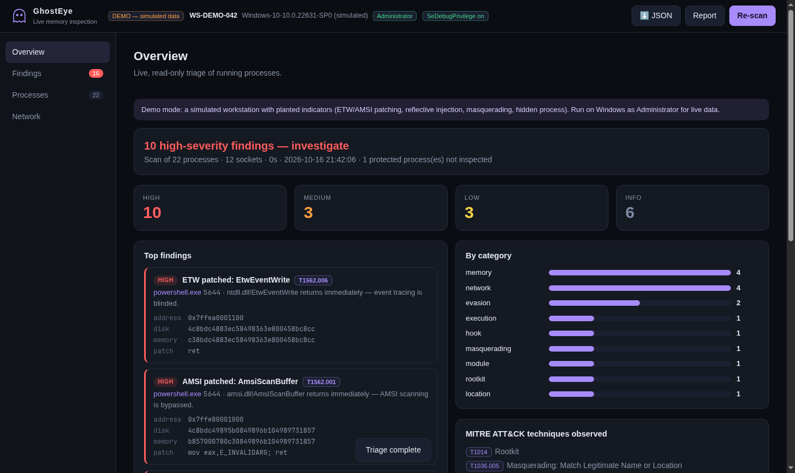
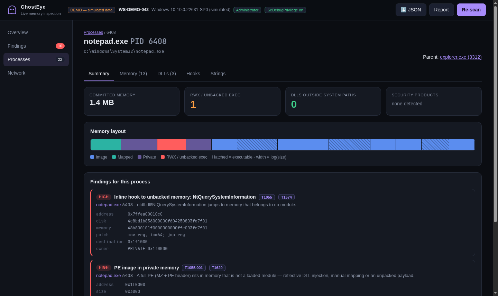
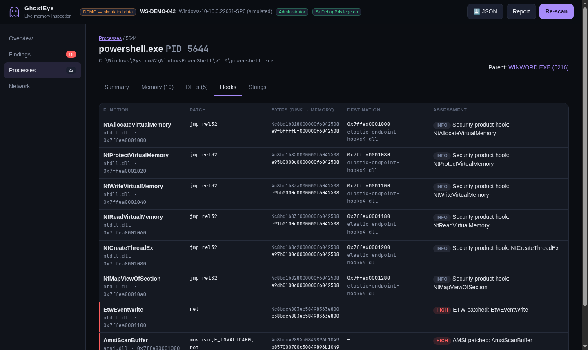

# GhostEye: Live Memory Inspection

> See what's hidden. No dump required.

GhostEye inspects running Windows processes directly through native APIs (`ctypes`): process tree, memory protections, injected code, inline hooks, hidden processes and network endpoints. It runs a full triage in a few seconds, explains every finding and maps it to MITRE ATT&CK.

**Read-only:** processes are opened with `PROCESS_QUERY_INFORMATION | PROCESS_VM_READ` only. Nothing is written, suspended or dumped.



---

## Quick start

```powershell
# Windows 10/11 x64, Python 3.8+ (64-bit), terminal opened "as Administrator"
git clone https://github.com/0xLhu/GhostEye.git
cd GhostEye
python main.py
```

The interface opens in your browser, then click **Run triage**. No dependency to install. A small local server listens on `127.0.0.1`, stop it with `Ctrl+C`.

On another OS, `python main.py --demo` opens the same interface on a simulated workstation with planted indicators.

---

## What it detects

| Check | How | ATT&CK |
|---|---|---|
| **ETW / AMSI patching** | `EtwEventWrite`, `NtTraceEvent`, `AmsiScanBuffer`… starting with `ret` / `xor eax,eax; ret` / `mov eax,E_INVALIDARG; ret` | T1562.006, T1562.001 |
| **Inline hooks** | Every export of ntdll, kernelbase, kernel32 and amsi compared with the file on disk, base relocations masked. Patch decoded (`jmp rel32/rel8`, `jmp [mem]`, `mov reg,imm64; jmp reg`, `push; ret`, `int3`) and destination resolved to a module or memory region | T1055, T1574 |
| **Security product hooks** | Destinations inside a known EDR/AV module (CrowdStrike, SentinelOne, Defender, Elastic, Sophos, Trend Micro…) are labelled *expected* and grouped, not raised as threats | - |
| **Injected PE** | MZ + PE header at the start of a private / file-less allocation | T1055.001, T1620 |
| **Shellcode-friendly memory** | RWX pages and executable private memory (lower severity in JIT hosts: browsers, .NET, Node, Office) | T1055, T1620 |
| **Masquerading** | Look-alike names (`svch0st.exe`, `lsas.exe`), system binaries outside `System32`, wrong parent (`lsass.exe` not spawned by `wininit.exe`), duplicated unique processes. PID reuse is handled with creation times | T1036.005 |
| **Suspicious execution chain** | Office / script hosts spawning PowerShell, cmd or LOLBins | T1218, T1059.001 |
| **DLLs from risky folders** | Temp, Downloads, Public, Recycle Bin… (high); other non-standard locations outside the app's own folder (low) | T1574.001 |
| **Hidden processes** | Cross-view of three sources: Toolhelp snapshot, `EnumProcesses`, and a PID brute force through `OpenProcess`. Candidates are re-checked to rule out race conditions | T1014 |
| **Network** | TCP + UDP, IPv4 + IPv6. Connections owned by hidden PIDs, LOLBins or system processes talking to the Internet, outbound SSH/RDP/WinRM/SMB to public IPs, non-standard ports | T1071, T1571, T1021 |
| **Strings** | ASCII + UTF-16 from private and mapped memory, tagged: URL, IP, command line, registry, evasion keywords (`AmsiUtils`, `MiniDumpWriteDump`…) | - |

Findings seen identically in many processes (typically EDR hooks) are merged into one line.

---

## Interface

| View | Content |
|---|---|
| **Overview** | Verdict, counts by severity, top findings, categories, ATT&CK techniques, processes that could not be inspected |
| **Findings** | All findings, filter by severity or free text (process, technique, DLL, function) |
| **Processes** | Process tree with worst severity per process |
| **Process** | Memory map (visual + table), DLLs with location risk and security products, on-demand hook scan, string extraction |
| **Network** | Endpoints with owning process and flags |

Exports: **JSON** (SIEM ingestion) and a printable **HTML report**.




---

## Command line

All original commands still work; `python main.py` with no command opens the interface.

```text
python main.py                        graphical interface
python main.py triage                 full triage in the terminal
python main.py triage --json out.json --html report.html
python main.py triage --no-hooks      faster, skips hook scan
python main.py list [name|pid]        processes (with image path)
python main.py scan <name|pid>        flagged memory regions (--all for every region)
python main.py scan <name> --pe       PE images in private memory
python main.py scan <name> --strings [--interesting] [--grep TEXT]
python main.py dll <name> [--suspicious]
python main.py hooks <name> [--module ntdll.dll,user32.dll]
python main.py hidden
python main.py network [--suspicious]
python main.py --demo <command>       any command on the simulated host
```

Processes can be selected by name (substring) or PID.

---

## Architecture

```
main.py                 entry point
ghosteye/
├── winapi.py           Win32 prototypes (explicit argtypes/restypes), SeDebugPrivilege
├── live.py             live backend: processes, memory, modules, network, hidden processes
├── pe.py               bounds-checked PE parser (exports, sections, relocations)
├── hooks.py            disk vs memory export comparison
├── analysis.py         detection rules → findings + ATT&CK mapping (pure Python)
├── triage.py           orchestration, strings, injected PE scan
├── report.py           JSON / HTML export
├── gui.py + web/       local web interface (standard library only, no CDN)
├── cli.py              command line
├── demo.py, synthpe.py simulated host built from real PE images (used by --demo and tests)
tests/                  python -m unittest discover -s tests
```

All detection logic is platform independent and unit-tested; only `winapi.py` / `live.py` touch Windows.

---

## Notes and limits

- **Run as Administrator.** GhostEye enables `SeDebugPrivilege`; without it most system processes are skipped. Protected processes (PPL: LSASS with RunAsPPL, AV services) cannot be read from user mode and are listed as *not inspected*.
- Use **64-bit Python** so 32-bit (WOW64) and 64-bit processes are both inspected without file-system redirection issues.
- **User-mode only.** Kernel hooks, SSDT patching and DKOM that also hides from `OpenProcess` are out of reach.
- Some security products and JIT runtimes legitimately hook APIs or allocate executable memory; GhostEye labels known cases, but always validate before concluding.
- Live analysis can be evaded by malware that watches for inspection.

---

## Roadmap

- [ ] Handle enumeration (handles to LSASS, `\Device\PhysicalMemory`)
- [ ] Process hollowing: compare on-disk and in-memory image sections of the main executable
- [ ] Hooks in `user32`, `win32u`, `ws2_32` by default; IAT / EAT hooks
- [ ] Authenticode check of loaded modules
- [ ] Baseline mode: diff two triage reports
- [ ] YARA scan of private memory

---

## License

Apache License 2.0, see [LICENSE](LICENSE). Copyright 2026 dandelion (0xLhu).

---

## Disclaimer

GhostEye is an educational forensics tool. **Use only on systems you are authorized to analyze.**
